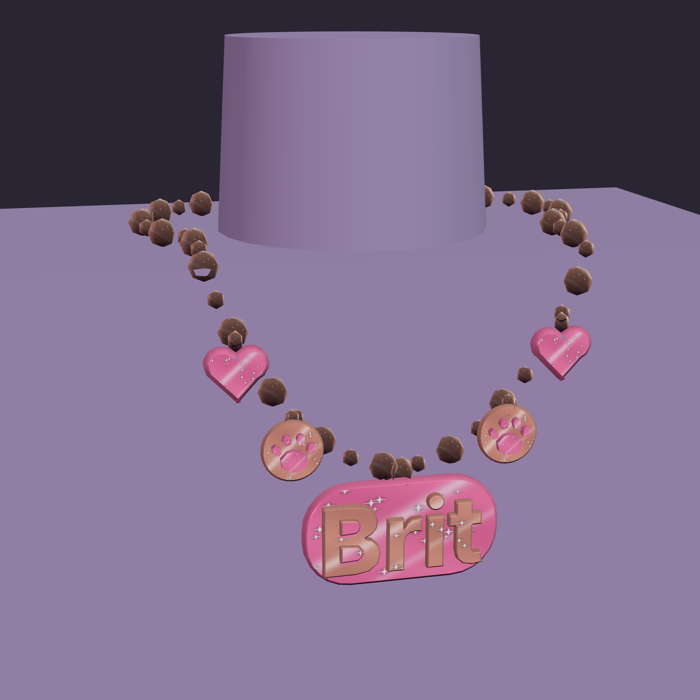

# Brit charm necklace (Roblox UGC neck accessory)

A rose gold bead chain with a pink "Brit" name plate in the center, two dog-paw charms
next to it and two pink hearts further out. The shine and sparkles are painted into the
texture because UGC accessories can't use real lights or particles.

*(Rendered in three.js on a Roblox-sized torso, which is 2×2×1 studs with the neck attachment on top.)*

| File | What it is |
|---|---|
| `BritNecklace.obj` / `.mtl` | The mesh: about 3,800 triangles, with smooth normals and rounded edges, under Roblox's 4,000 limit for accessories. Units are studs and the front faces -Z. |
| `BritNecklace_texture.png` | A 512×512 texture with the rose gold, pink, highlights and sparkles. |
| `PreviewNecklace.server.lua` | A Studio test script that puts the necklace on every player (works for R6 and R15). |
| `build_necklace.py` | Rebuilds everything. `python3 build_necklace.py OtherName` makes it with a different name. Needs `pip install numpy pillow shapely fonttools mapbox_earcut`. |
| `render_preview.js` | Re-renders `preview.png`: `node render_preview.js path/to/three.min.js` |

## Turning it into a real UGC item
1. In Roblox Studio, open **Avatar → Accessory Fitting Tool**, and import `BritNecklace.obj` with the texture.
2. Set the type to **Neck**, put it on the R15 and R6 test mannequins, and adjust the fit.
3. Run the tool's validation, then **Publish to Roblox**. You need UGC upload access, which means
   ID verification and Roblox Premium. Roblox also charges an upload fee and a publishing advance
   in Robux. Check the current amounts on the Creator Hub, because they change.
4. Roblox moderation reviews it. Names are fine, but don't use real brands or other people's logos.
